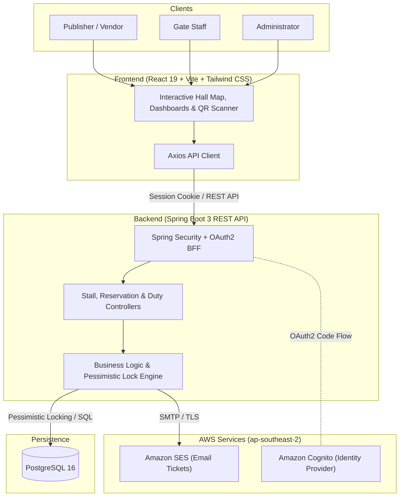
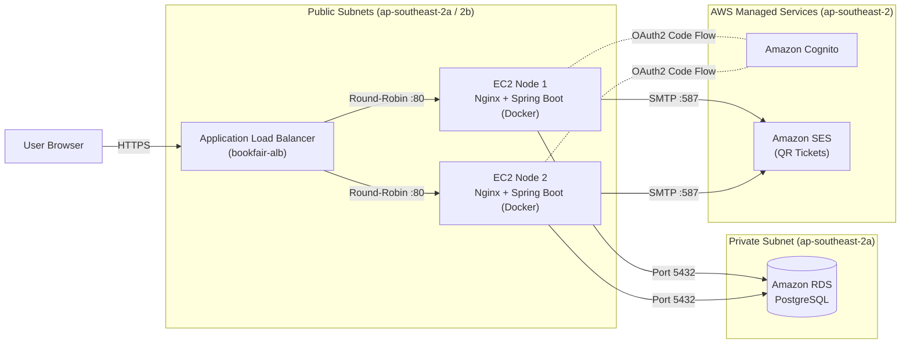
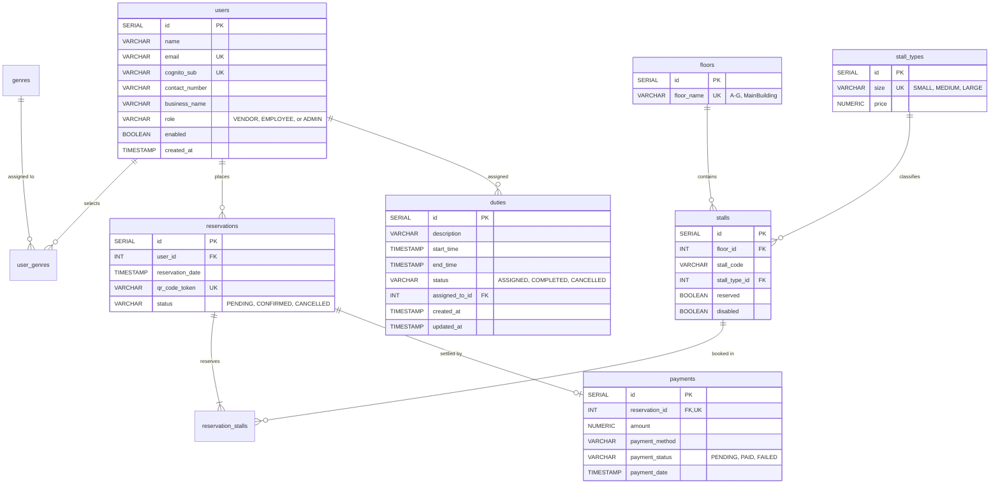

# Colombo International Book Fair (CIBF) Platform

A full-stack web application built for managing stall reservations and event operations at the Colombo International Book Fair (BMICH). The platform enables book publishers to browse live hall availability and reserve stalls, gate staff to validate attendee passes using camera QR scanning, and administrators to oversee reservations, stall inventory, and staff duties.

---

## 🏛️ System Architecture

The application is built as a **modular monolith** with a Spring Boot 3 REST API backend and a React 19 single-page frontend.



---

## ☁️ Cloud Architecture (Selected Region: `ap-southeast-2`)

Deployed in AWS Sydney (`ap-southeast-2`) within a custom VPC separating public web tiers from private persistence subnets.



---

## ✨ Key Features

- **Interactive Floor Map:** Visual SVG floor plan of BMICH halls (A–G and Main Building) with live stall availability.
- **Real-Time Stall Booking:** Reserve up to 3 stalls with database pessimistic locking (`SELECT ... FOR UPDATE`) to eliminate double-booking race conditions.
- **Digital Tickets & QR Verification:** Automated confirmation emails with embedded QR passes via Amazon SES, verifiable in real time using the built-in camera scanner.
- **Role-Based Access Control:** Dedicated interfaces and permissions for Publishers (`ROLE_VENDOR`), Gate Security (`ROLE_EMPLOYEE`), and Administrators (`ROLE_ADMIN`).
- **Event Operations Management:** Admin tools to toggle stall availability, adjust pricing, schedule staff duty shifts, and audit reservations.

---

## 🛠️ Tech Stack

| Layer | Technologies |
| :--- | :--- |
| **Frontend** | React 19, Vite, Tailwind CSS v4, React Router v7, HTML5-QRCode, Heroicons |
| **Backend** | Java 25, Spring Boot 4.x, Spring Security 7, Spring Data JPA, ZXing (QR) |
| **Database** | PostgreSQL 16 |
| **Cloud (AWS `ap-southeast-2`)** | EC2 (Ubuntu), Amazon RDS PostgreSQL, Amazon SES, Amazon Cognito |
| **DevOps** | Docker, Docker Compose, Nginx, GitHub Actions |

---

## 🗄️ Database Schema



---

## 🚀 Getting Started

### Prerequisites
- [Docker & Docker Compose](https://www.docker.com/) (recommended)
- *Or manual:* Java 25+, Node.js 18+, PostgreSQL 15+

### Quickstart with Docker Compose

1. **Clone the repository and copy the environment template:**
   ```bash
   cp .env.example .env
   ```

2. **Generate a JWT secret:**
   ```bash
   openssl rand -base64 32
   ```
   Paste the generated string into `JWT_SECRET` in `.env`.

3. **Start all services:**
   ```bash
   docker compose up --build
   ```

4. **Access the application:**
   - **Frontend:** `http://localhost:3000` (or `http://localhost:5173` if running Vite dev server)
   - **Backend API:** `http://localhost:8080/api`
   - **Database:** `localhost:5432`

---

### Manual Setup (Without Docker)

#### 1. Database Setup
```bash
createdb -U postgres bookfair_db
psql -U postgres -d bookfair_db -f database/schema.sql
psql -U postgres -d bookfair_db -f database/seed.sql
```

#### 2. Backend Setup

Copy `.env.example` to `.env` in the project root and fill in the Cognito pool ID, client ID, client secret, and hosted domain. For an IntelliJ run, Spring Boot reads this file automatically. Start PostgreSQL locally and set `SPRING_DATASOURCE_PASSWORD` in `.env` to the same password configured for the local database.

```bash
cd backend
./mvnw spring-boot:run
```

#### 3. Frontend Setup
```bash
cd frontend
npm install
npm run dev
```

---

## ⚙️ Environment Variables

| Variable | Description | Default / Example |
| :--- | :--- | :--- |
| `POSTGRES_DB` | Database name | `bookfair_db` |
| `POSTGRES_USER` | Database user | `postgres` |
| `POSTGRES_PASSWORD` | Database password | *(Set a strong password)* |
| `JWT_SECRET` | 256-bit Base64 HMAC secret key | `openssl rand -base64 32` |
| `SPRING_MAIL_HOST` | Amazon SES SMTP Host (selected Region) | `email-smtp.ap-southeast-2.amazonaws.com` |
| `SPRING_MAIL_PORT` | Amazon SES SMTP Port | `465` (SMTPS) or `587` (STARTTLS) |
| `SPRING_MAIL_USERNAME`| Amazon SES SMTP Username | *(From AWS SES credentials)* |
| `SPRING_MAIL_PASSWORD`| Amazon SES SMTP Password | *(From AWS SES credentials)* |
| `APP_MAIL_FROM` | Verified sender email address | `tickets@yourdomain.com` |
| `CORS_ALLOWED_ORIGINS`| Whitelisted CORS origin URLs | `http://localhost:3000,http://localhost:5173` |
