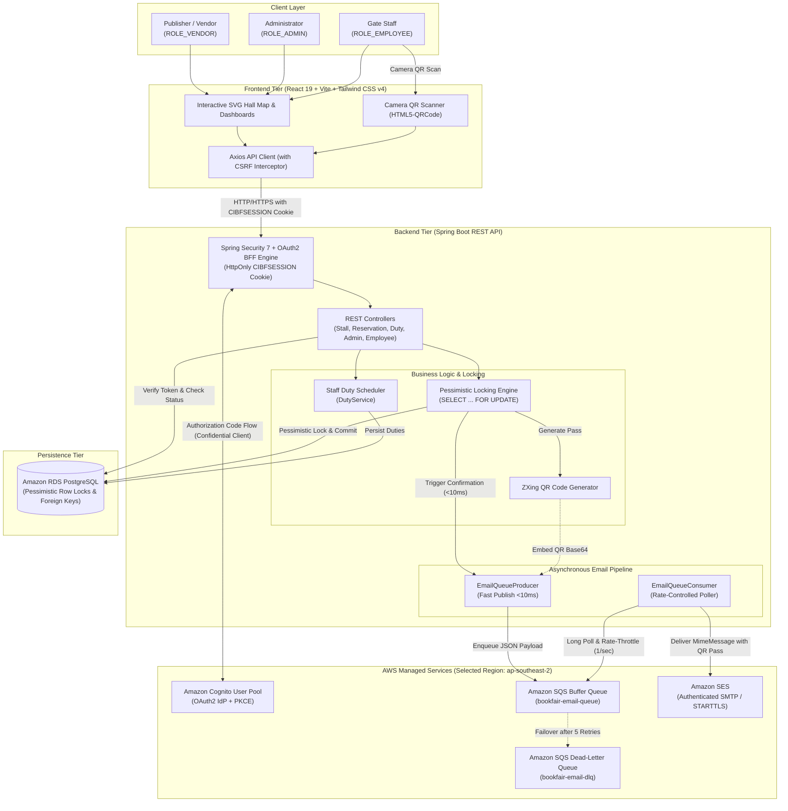
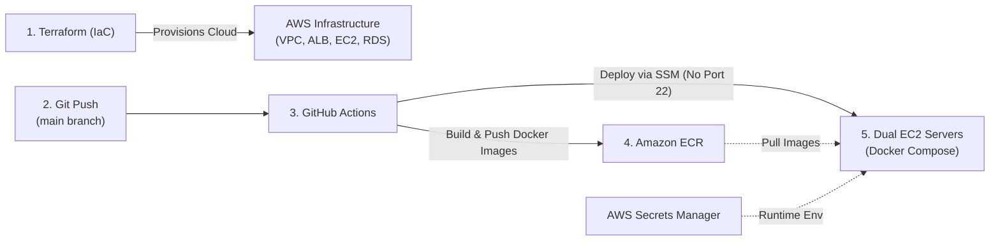
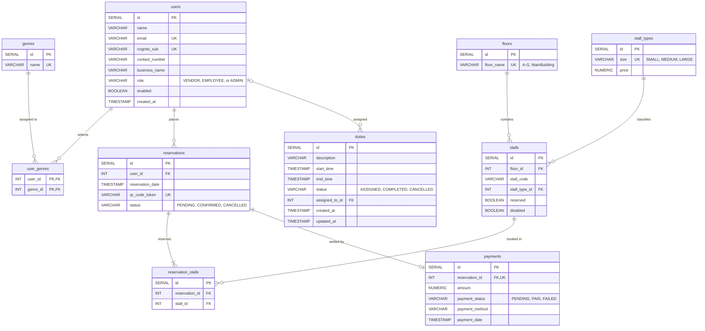

# Colombo International Book Fair (CIBF) Platform

A full-stack web application built for managing stall reservations and event operations at the Colombo International Book Fair (BMICH). The platform allows book publishers to view live hall availability and reserve stalls, gate staff to verify attendee passes using camera QR scanning, and administrators to oversee reservations, stall inventory, and staff duties.

---

## 🏛️ System Architecture

The application is built as a **modular monolith** with a Spring Boot REST API backend and a React 19 single-page frontend, using the **Backend-For-Frontend (BFF)** pattern with server-side OAuth 2.0 session cookies.



---

## ☁️ Cloud Infrastructure Architecture (Selected Region: `ap-southeast-2`)

The infrastructure is deployed in AWS Sydney (**`ap-southeast-2`**) adhering to the **AWS Well-Architected Framework**. It features a custom Multi-AZ Virtual Private Cloud (VPC), dual EC2 compute nodes fronted by an Application Load Balancer, an isolated RDS database, and managed AWS services.

```mermaid
flowchart TD
    subgraph PublicInternet ["Public Internet"]
        Users["Browser & Mobile Clients\n(https://bookfair.larmora.com)"]
        GHActions["GitHub Actions CI/CD Runner\n(Automated Testing & Builds)"]
    end

    subgraph AWSCloud ["AWS Cloud (Selected Region: ap-southeast-2)"]
        IGW["Internet Gateway (bookfair-igw)"]

        subgraph VPC ["Custom VPC: bookfair-vpc (10.0.0.0/16)"]
            
            subgraph IngressTier ["High-Availability Ingress Tier"]
                ALB["AWS Application Load Balancer\n(bookfair-alb :80 / :443)"]
            end

            subgraph ComputeTier ["Multi-AZ Compute Tier (Public Subnets)"]
                direction LR
                subgraph AZ_A_Web ["AZ: ap-southeast-2a (Public Subnet 1 - 10.0.1.0/24)"]
                    EC2_1["EC2 Node 1 (bookfair-web-server-1)\n- Nginx Reverse Proxy (:80)\n- React 19 Frontend Container (:3000)\n- Spring Boot Backend Container (:8080)"]
                end

                subgraph AZ_B_Web ["AZ: ap-southeast-2b (Public Subnet 2 - 10.0.2.0/24)"]
                    EC2_2["EC2 Node 2 (bookfair-web-server-2)\n- Nginx Reverse Proxy (:80)\n- React 19 Frontend Container (:3000)\n- Spring Boot Backend Container (:8080)"]
                end
            end

            subgraph DatabaseTier ["Multi-AZ Persistence Tier (VPC DB Subnet Group)"]
                direction LR
                subgraph AZ_A_DB ["AZ: ap-southeast-2a (Private Subnet 1 - 10.0.10.0/24)"]
                    RDS_Master[("Amazon RDS PostgreSQL :5432\n(Primary Master Instance)")]
                end

                subgraph AZ_B_DB ["AZ: ap-southeast-2b (Private Subnet 2 - 10.0.20.0/24)"]
                    SubnetStandby["Multi-AZ DB Subnet Reserve\n(Scale-Up Ready)"]
                end
            end
        end

        subgraph ManagedServices ["AWS Managed Services Tier (ap-southeast-2)"]
            Cognito["Amazon Cognito User Pool\n(OAuth2 / OIDC Identity Provider)"]
            SQSQueue["Amazon SQS Primary Queue\n(bookfair-email-queue)"]
            SQSDLQ["Amazon SQS Dead-Letter Queue\n(bookfair-email-dlq)"]
            SESService["Amazon SES\n(email-smtp.ap-southeast-2.amazonaws.com)"]
            ECR["Amazon ECR Registries\n(cibf-backend, cibf-frontend)"]
            SSM["AWS Systems Manager\n(SSM RunCommand Deployment Agent)"]
            SecretsManager["AWS Secrets Manager\n(Runtime App & DB Secrets)"]
            S3State["Amazon S3 + DynamoDB\n(Remote Terraform State & Locks)"]
        end
    end

    Users -->|"1. HTTPS Requests"| IGW
    IGW --> ALB
    ALB -->|"2. Health-Checked Round-Robin"| EC2_1
    ALB -->|"2. Health-Checked Round-Robin"| EC2_2

    EC2_1 -->|"3. Private SQL (:5432)"| RDS_Master
    EC2_2 -->|"3. Cross-AZ Private SQL (:5432)"| RDS_Master

    EC2_1 & EC2_2 <-->|"4. OAuth2 Token Exchange & PKCE"| Cognito

    EC2_1 & EC2_2 -->|"5. Fast Event Enqueue (<10ms)"| SQSQueue
    SQSQueue -.->|"Max 5 Retries Exceeded"| SQSDLQ
    EC2_1 & EC2_2 -.->|"6. Long Poll Messages (1/sec)"| SQSQueue

    EC2_1 & EC2_2 -->|"7. Deliver QR Passes (STARTTLS :587)"| SESService

    GHActions -->|"A. Push Docker Images"| ECR
    GHActions -->|"B. Dispatch RunShellScript"| SSM
    SSM -->|"C. Execute aws-deploy.sh"| EC2_1 & EC2_2
    EC2_1 & EC2_2 -.->|"D. Fetch Secrets"| SecretsManager
    EC2_1 & EC2_2 -.->|"E. Pull Images"| ECR
```



---

## ✨ Platform Capabilities

- **Interactive SVG Floor Map:** Real-time visual floor plan of BMICH exhibition halls (A–G and Main Building) dynamically color-coded by stall size and availability status.
- **Digital QR Tickets & In-Browser Camera Scanner:** Automated confirmation emails with embedded ZXing QR code passes, verifiable on-site by gate security staff using mobile/desktop browser cameras without native app downloads.
- **Role-Based Access Control (RBAC):** Dedicated views, workflows, and protected API endpoints for Book Publishers (`ROLE_VENDOR`), Gate Security Staff (`ROLE_EMPLOYEE`), and System Administrators (`ROLE_ADMIN`).
- **Staff Operations & Duty Management:** Centralized administration dashboard to manage user access, schedule and assign event staff shifts, monitor live attendee check-ins, and manage hall inventories.
- **Transactional Stall Reservations:** Business-limited reservation engine (up to 3 stalls per publisher) with instant price calculations and automated receipt generation.

---

## 🔄 CI/CD & Deployment Workflow

The deployment workflow uses Terraform for cloud provisioning and GitHub Actions for automated, zero-SSH container delivery:


---

## 🛠️ Tech Stack

| Layer | Technologies |
| :--- | :--- |
| **Frontend** | React 19, Vite, Tailwind CSS v4, React Router v7, HTML5-QRCode, Heroicons |
| **Backend** | Java 17+ (LTS), Spring Boot 4.x, Spring Security 7, Spring Data JPA, Hibernate, ZXing (QR) |
| **AWS SDK & Cloud** | AWS SDK for Java v2 (`software.amazon.awssdk:sqs`), Jackson Databind |
| **Database** | PostgreSQL 16 (Amazon RDS) |
| **Cloud (AWS `ap-southeast-2`)** | Application Load Balancer, EC2 (Dual Linux Nodes), Amazon RDS, Amazon SQS + DLQ, Amazon SES, Amazon Cognito, Amazon ECR, AWS SSM, AWS Secrets Manager, Amazon S3, Amazon DynamoDB |
| **DevOps & IaC** | HashiCorp Terraform, Docker, Nginx, GitHub Actions |
---

## 🗄️ Database Schema



---

## 🚀 Getting Started

### Prerequisites
- [Docker & Docker Compose](https://www.docker.com/) (recommended)
- *Or manual:* Java 17+, Node.js 22+, PostgreSQL 16+

### Quickstart with Docker Compose

1. **Clone the repository and copy the environment template:**
   ```bash
   cp .env.example .env
   ```

2. **Start all services:**
   ```bash
   docker compose up --build
   ```

3. **Access the application:**
   - **Frontend:** `http://localhost:3000` (or `http://localhost:5173` in Vite dev server)
   - **Backend API:** `http://localhost:8080/api`
   - **Database:** `localhost:5432`

---

### Manual Setup (Local Development)

#### 1. Database Setup
```bash
createdb -U postgres bookfair_db
psql -U postgres -d bookfair_db -f database/schema.sql
psql -U postgres -d bookfair_db -f database/seed.sql
```

#### 2. Backend Setup
Set environment variables in `.env` in the project root, then run:

```bash
cd backend
./mvnw spring-boot:run
```

#### 3. Frontend Setup
```bash
cd frontend
npm install
npm run dev
```

---

